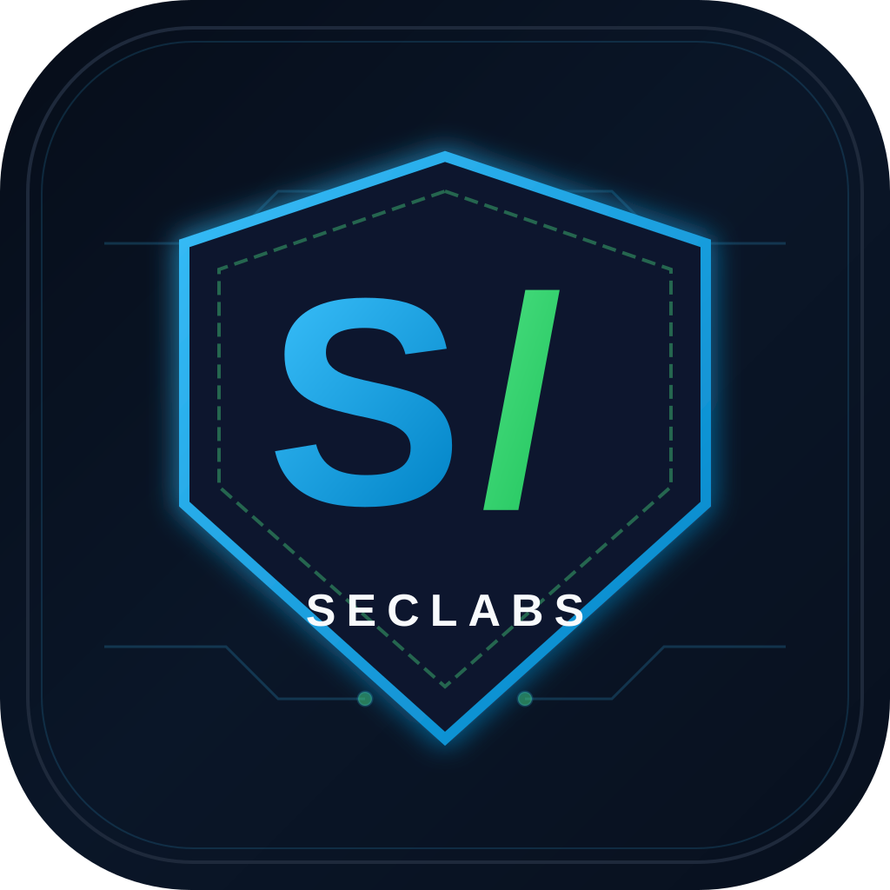

# SecLabs Offensive Engineering
### Enterprise Red Team Blueprints • Advanced Adversary Emulation • Interactive Runbooks

  
  
  
  

`

---

### ⚡ Operational Overview

`ash
╔═══════════════════════════════════════════════════════════════════════════════════════════╗
║ [OPERATIONAL DISPATCH] : SECLABS OFFENSIVE ENGINEERING RESEARCH GROUP                     ║
╠═══════════════════════════════════════════════════════════════════════════════════════════╣
║ [+] Identity          : SecLabs Independent Security Research                             ║
║ [+] Primary Focus     : Enterprise Red Teaming, Multi-Forest AD, Cloud Identity Abuse     ║
║ [+] Methodology       : 100% Empirically Validated Lab Topologies & Verified Exploit Chains║
║ [+] Interactive Stack : Cloudflare Edge • Zero-Install Browser Runbooks • Encrypted Tokens║
║ [+] Research Library  : 143+ Full Enterprise & Platform Walkthroughs (HTB / THM)          ║
║ [+] Support Channel   : Priority Operator Assistance via Telegram (@seclabs_support)     ║
╚═══════════════════════════════════════════════════════════════════════════════════════════╝
``

---

### 🛡️ Why Top Red Teams & Security Operators Trust SecLabs

At **SecLabs**, we bridge the critical gap between theoretical security syllabi and high-stakes operational execution. Our interactive runbooks are engineered by active penetration testers and offensive security practitioners who audit, simulate, and assess complex modern infrastructure.

- 🔬 **Empirical Lab Validation:** Every single command line, PowerShell script, C2 profile, and exploit chain has been executed, timed, and verified against modern virtualized enterprise networks. Zero theoretical guesswork.
- 🎯 **Unredacted End-to-End Attack Chains:** Complete lateral movement workflows — from external web reconnaissance and initial access to Kerberos delegation abuse, cross-forest trust dominance, and cloud tenant takeover.
- 🔐 **Instant Zero-Friction Delivery:** Receive a cryptographic license token instantly upon checkout. Opens directly in your browser with interactive syntax highlighting, live command search, instant copy-to-clipboard, and bilingual explanations (English & Spanish).
- 🤝 **Direct Operator Support:** We provide direct 1-on-1 operational support via Telegram (@seclabs_support) to ensure your technical preparation is flawless.`

---

### ⚔️ Tradecraft & Arsenal Matrix

| Operational Domain | Core Tooling & Tradecraft Blueprints |
| :--- | :--- |
| **Active Directory Multi-Forest** | BloodHound Enterprise • Rubeus • Mimikatz • Powermad • ADCS (ESC1-ESC8) • Kerberoasting • AS-REP Roasting |
| **Kerberos & Trust Attacks** | RBCD (Resource-Based Constrained Delegation) • S4U2Self / S4U2Proxy • Diamond Tickets • Golden/Silver Tickets • Extra SID Hopping • Foreign Security Principals |
| **Cloud & Hybrid Identity** | Azure Entra ID • Managed Identity Abuse ($IDENTITY_ENDPOINT) • Key Vault Extraction • Cosmos DB RBAC • Conditional Access Policy Bypass • App Registration Secret Injection |
| **C2 Infrastructure & Evasion** | Cobalt Strike C2 • Arsenal Kit • Artifact Kit • Process Hollowing • Direct System Calls • AMSI / ETW Patching • Token Duplication • SCShell |
| **Advanced Web Exploitation** | Server-Side Template Injection (SSTI) • Java / .NET Deserialization • Second-Order SQLi • SSRF Pivoting • OAuth2 Flow Manipulation • Race Conditions |

`

---

### 📚 Featured Master Certification Runbooks

Our interactive master runbooks are engineered to mirror complex enterprise production lab topologies:

| Program | Provider | Focus Area | Complexity | Interactive Blueprint |
| :--- | :--- | :--- | :---: | :---: |
| **CARTP** | Altered Security | Cloud Red Teaming, Entra ID, Managed Identity, Cosmos DB, Key Vault | Advanced | [Explore Deep Dive](https://github.com/seclabsguides/seclabs_store/blob/main/articles/CARTP_Articulo_DevTo.md) |
| **CRTE** | Altered Security | Multi-Forest Active Directory, Extra SID, RBCD, Shadow Credentials | Expert | [Explore Deep Dive](https://github.com/seclabsguides/seclabs_store/blob/main/articles/CRTE_Articulo_DevTo.md) |
| **CRTM** | Altered Security | Diamond Tickets, PKINIT ADCS, Cross-Realm Trusts, Enterprise Dominance | Master | [Explore Deep Dive](https://github.com/seclabsguides/seclabs_store/blob/main/articles/CRTM_Articulo_DevTo.md) |
| **CRTO** | Zero-Point Security | Cobalt Strike Operations, Payload Obfuscation, Lateral Movement, Evasion | Advanced | [Explore Deep Dive](https://github.com/seclabsguides/seclabs_store/blob/main/articles/CRTO_Articulo_DevTo.md) |
| **OSEP (PEN-300)** | Offensive Security | Custom Shellcode Loaders, Process Injection, AppLocker, MSSQL Links | Advanced | [Explore Deep Dive](https://github.com/seclabsguides/seclabs_store/blob/main/articles/OSEP_Articulo_DevTo.md) |
| **CPTS** | Hack The Box | Full Commercial Pentest Methodology, Pivoting, AD Chains, Executive Reports | Advanced | [Explore Deep Dive](https://github.com/seclabsguides/seclabs_store/blob/main/articles/CPTS_Articulo_DevTo.md) |
| **CWES** | Altered Security | 100-Point Enterprise Web Assessment, Multi-Port Audit, Zero-Downtime Defense | Advanced | [Explore Deep Dive](https://github.com/seclabsguides/seclabs_store/blob/main/articles/CWES_Articulo_DevTo.md) |`

---

### 📂 Open Technical Knowledge Base

In addition to our flagship interactive runbooks, we maintain a comprehensive open-access technical repository with **over 143 detailed walkthroughs**:

- 🏢 **[seclabs_store Repository](https://github.com/seclabsguides/seclabs_store)**: Centralized catalog containing:
  - **32 TryHackMe Walkthroughs**: Complete exploitation pathways, privilege escalation notes, and lessons learned.
  - **111 HackTheBox Walkthroughs**: Detailed lab breakdowns across Linux, Windows, and Active Directory targets.
  - **7 Master Certification Articles**: Technical deep dives and architecture reviews.`

---

### 🔐 Independent Research & Ethics Notice

> [!NOTE]
> **SecLabs Guides** operates strictly as an independent educational and offensive security tradecraft research group. All runbooks, articles, and blueprints are developed for authorized security assessments, academic preparation, and enterprise defense hardening. We strictly adhere to responsible disclosure principles and vendor study guidelines.`

---

### 🌐 Connect With SecLabs

&nbsp;

&nbsp;

  &copy; 2026 SecLabs Guides • Independent Offensive Security Research • All Rights Reserved.

